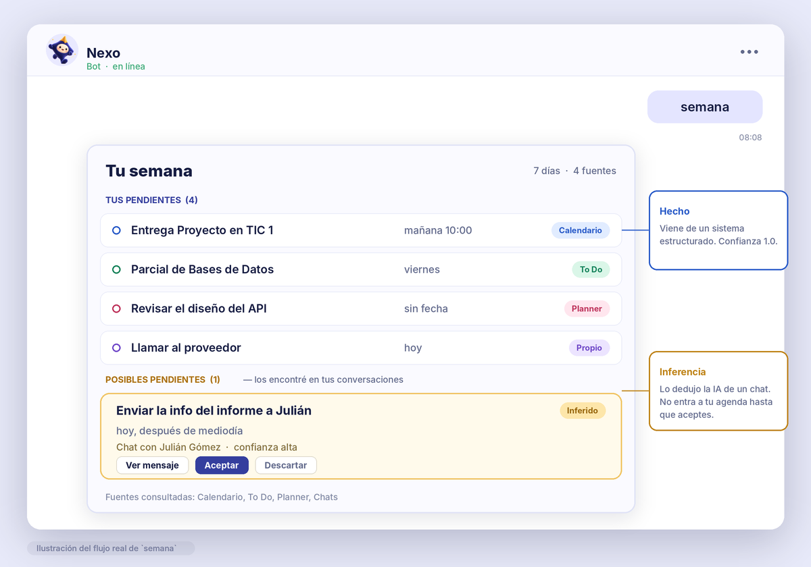
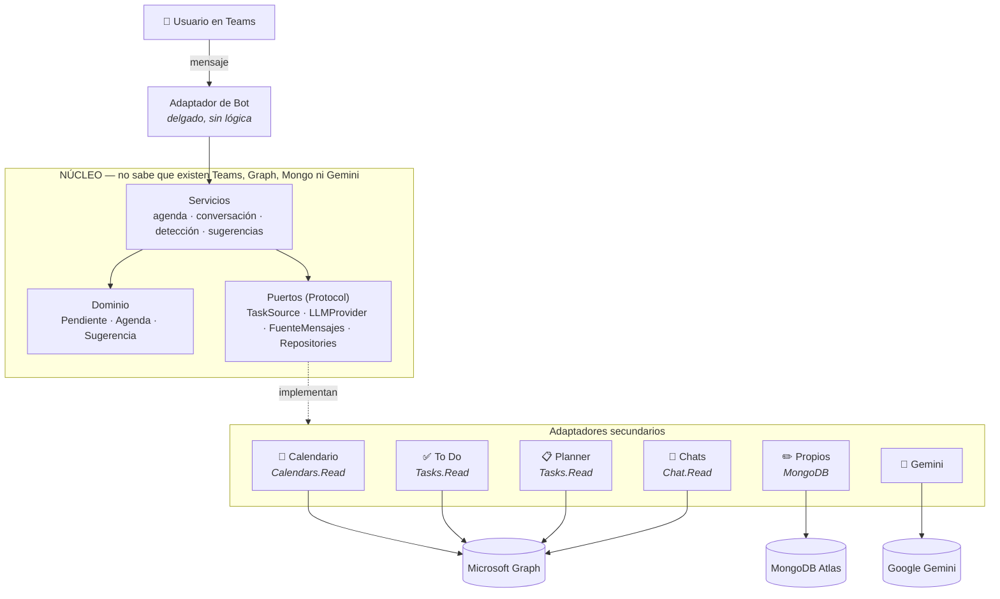
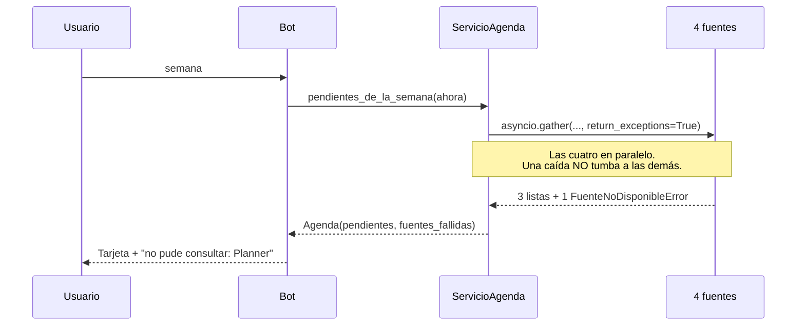

<div align="center">

  

  <h3>Tus pendientes están regados entre Planner, To Do, el calendario y un mensaje perdido en un chat.<br/>
  Nexo los reúne todos — y encuentra los que nadie anotó.</h3>

  <p>
    
    
    
    
    
  </p>
  <p>
    
    
    
    
  </p>

  [En 30 segundos](#en-30-segundos) · [Qué hace](#qué-hace) · [Arquitectura](#arquitectura) · [**Verifícalo tú mismo**](#verifícalo-tú-mismo) · [Instalación](#instalación-rápida-desarrollo) · [**Wiki de implantación**](../../wiki)

</div>

---

## En 30 segundos

| | |
|---|---|
| **Qué es** | Un agente de IA que vive dentro de Microsoft Teams y conoce tus compromisos: los de tu calendario, To Do y Planner, **y los que quedaron escondidos en un chat**. |
| **Para quién** | Estudiantes, docentes y profesionales que trabajan dentro de Microsoft 365 y no quieren que algo importante se pierda entre mensajes. |
| **Qué lo hace distinto** | Separa lo que **es un hecho** de lo que **la IA infiere**: nada deducido de una conversación entra a tu agenda hasta que tú lo aceptas. Y cada pendiente trae el enlace a su origen. |
| **Qué garantiza** | Solo lectura, con permisos delegados del propio usuario. Si una fuente falla, lo dice: nunca lo disfraza de "no tienes nada". |
| **Cómo probarlo** | Escríbele `semana` al bot en Teams, o levanta el proyecto local: arranca **sin credenciales**, con datos de ejemplo. |

---

## El problema

Una persona que trabaja o estudia dentro de Microsoft 365 tiene sus compromisos repartidos en cuatro sitios que no se hablan entre sí:

- Un **evento** en el calendario de Outlook.
- Una **tarea** en Microsoft To Do.
- Una **tarjeta** en un plan de Planner.
- Y, sobre todo, **una frase suelta en un chat**: *"listo, mañana te paso el informe"*.

Las tres primeras requieren que alguien se haya tomado el trabajo de anotarlas. **La cuarta es la que de verdad se olvida**, y es justamente la que ninguna de esas tres herramientas recoge, porque ninguna lee tus conversaciones.

## Qué hace

Nexo es un **bot de Microsoft Teams** que responde a *"¿qué tengo esta semana?"* unificando esas cuatro fuentes, y devuelve dos listas separadas:

<div align="center">
  
  <br/><sub><i>Ilustración del flujo real de <code>semana</code>. Arriba, lo que es un hecho; abajo, lo que la IA infirió y espera tu confirmación.</i></sub>
</div>

<details>
<summary><b>Ver la misma respuesta en texto</b></summary>

```
📋 TUS PENDIENTES (4)
  • Entrega Proyecto en TIC 1 — mañana 10:00        📅 Calendario
  • Parcial de Bases de Datos — viernes             ✅ To Do
  • Revisar el diseño del API — sin fecha           📋 Planner
  • Llamar al proveedor — hoy                       ✏️ Propio

💡 POSIBLES PENDIENTES (1)  — los encontré en tus conversaciones
  • Enviar la info del informe a Julián — hoy después de mediodía
    💬 Chat con Julián Gómez · confianza alta    [Ver mensaje] [Aceptar] [Descartar]
```

</details>

### Las cuatro ideas que lo definen

| | |
|---|---|
| **Nunca miente por omisión** | Si una fuente falla, Nexo **lo dice**. Un error jamás se traduce en una lista vacía: `200 OK []` es "no tienes nada"; un `403` es "no pude preguntarle a Planner". Confundirlos es mentir. |
| **Hecho ≠ inferencia** | Lo que viene de un sistema estructurado tiene `confianza = 1.0`. Lo que infiere el modelo a partir de un chat **no entra en la agenda hasta que el usuario lo confirma**: vive en una bandeja aparte, marcado en amarillo. |
| **Trazabilidad obligatoria** | Cada pendiente trae el enlace a su origen exacto. Siempre se puede preguntar *"¿de dónde sacaste eso?"* y llegar en un clic. |
| **Solo lo tuyo** | Autenticación delegada: Nexo actúa **con el token del usuario**. No puede ver nada que esa persona no pueda ver ya. Sin permisos de aplicación sobre la organización. |

## Comandos

| Comando | Qué hace |
|---|---|
| `semana` | Pendientes de los próximos 7 días, de las cuatro fuentes |
| `recuérdame <texto> [el viernes]` | Anota un pendiente propio |
| `listo <n>` · `borrar <n>` | Completa o elimina un pendiente propio |
| `vigilar` · `no vigilar` | Activa o apaga el análisis de conversaciones (**opt-in**) |
| `revisar` | Propone los compromisos detectados en tus chats |
| `chat <pregunta>` | Conversación general con memoria; acepta imágenes, PDF, Word y Excel |
| `olvidar` | Borra la memoria de esa conversación |
| `conectar` · `desconectar` | Autoriza o revoca el acceso a tus datos de Microsoft 365 |
| `estado` | Si los datos que ves son reales o de ejemplo, ahora mismo |
| `ayuda` | El menú |

También responde en lenguaje natural sobre tus pendientes, estudio o trabajo: *"¿qué es lo más urgente?"*, *"¿tengo algo el viernes?"*.

## Cómo funciona



### El flujo de `semana`



## Arquitectura

**Hexagonal (puertos y adaptadores)**, con las carpetas en español por decisión del equipo.

```
app/
├── dominio/       # Modelo propio. Solo librería estándar.
├── puertos/       # Interfaces (typing.Protocol). Lo que el núcleo necesita.
├── servicios/     # Casos de uso. Dependen de puertos, nunca de implementaciones.
├── adaptadores/   # Graph, Mongo, Gemini, extractores. Secundarios.
├── api/           # Adaptador primario: FastAPI (/health, /api/agenda, landing)
├── bot/           # Adaptador primario: Microsoft Teams
├── seguridad/     # Cifrado Fernet de tokens persistidos
├── composicion.py # Composition root: el ÚNICO sitio que ensambla concretos
├── worker.py      # Proceso aparte: precarga sin bloquear al bot
└── main.py
```

### La regla se verifica sola

`tests/test_arquitectura.py` es una **función de aptitud**: recorre el AST de cada archivo y rechaza las dependencias prohibidas.

| Si alguien escribe… | El test falla con… |
|---|---|
| un `import` de infraestructura en `dominio/` | *"el dominio solo usa librería estándar"* |
| un servicio importando un adaptador | *"un servicio depende de puertos, no de implementaciones"* |
| un adaptador llamando a un servicio | *"un adaptador secundario no orquesta"* |

No es decorativa: **atrapó al propio equipo** colocando una fábrica en `servicios/` durante la OT-02B.

### La prueba de que sirvió

Entre la primera fuente y hoy el proyecto pasó de **1 a 4 fuentes** de datos, más lectura de documentos, memoria de chat e imágenes:

```
app/dominio/agenda.py              0 cambios
app/servicios/servicio_agenda.py   0 cambios
```

Añadir un origen de datos cuesta **un archivo nuevo y una línea en `composicion.py`**. Eso no es una opinión sobre arquitectura: es un `git diff`.

## Calidad

Cuatro compuertas, verificadas en entorno limpio antes de cada entrega — `venv` recién creado e instalación desde cero, porque **un entorno reusado no verifica una instalación**:

```bash
ruff check .          # ✅ limpio
ruff format --check . # ✅ 108 archivos
mypy                  # ✅ strict, sin errores en 108 archivos
pytest                # ✅ 276 tests
```

5.671 líneas de `app/` frente a 5.092 de `tests/`. El script `verificar-ci.ps1` reproduce el runner de CI en Windows de un solo comando. El pipeline de GitHub Actions ejecuta las cuatro y, solo si pasan, construye la imagen y despliega.

## Verifícalo tú mismo

No pedimos que nos creas: cada afirmación de este README se puede comprobar en el código.

| Afirmación | Cómo comprobarla |
|---|---|
| El núcleo no depende de la infraestructura | `pytest tests/test_arquitectura.py` — recorre el AST y falla si alguien rompe la regla |
| Un fallo nunca se disfraza de lista vacía | `tests/test_servicio_agenda.py` — verifica que una fuente caída aparece en `fuentes_fallidas` con su motivo (ej. `403`) |
| Lo inferido no entra a la agenda sin confirmación | `tests/test_servicio_sugerencias.py` — aceptar crea el pendiente y aceptar una sugerencia inexistente no crea nada |
| Solo lectura, con permisos mínimos | `docs/GUIA-INSTALACION-TI.md` — tabla de permisos: `Calendars.Read`, `Tasks.Read`, `Chat.Read` |
| Añadir una fuente cuesta un archivo | Un adaptador en `app/adaptadores/` y una línea en `app/composicion.py` |
| Arranca sin credenciales | `uvicorn app.main:app` y `http://localhost:8000/health` responde `200` |

Para correr todo de una vez: `pip install -r requirements-dev.txt && pytest`.

## Privacidad

| Pregunta | Respuesta |
|---|---|
| ¿Qué puede ver Nexo? | Solo lo que el usuario ya puede ver. Autenticación delegada, nunca permisos de aplicación sobre la organización. |
| ¿Guarda contraseñas? | **Nunca.** El login ocurre entero dentro de Microsoft. |
| ¿Guarda tokens? | Los *refresh tokens* necesarios para la precarga se guardan **cifrados con Fernet**; la clave vive solo en el servidor. |
| ¿Lee mis conversaciones? | **Solo si lo activas con `vigilar`**, solo los últimos 7 días, y se apaga con `no vigilar`. |
| ¿Guarda mis mensajes? | **No.** Se procesan en memoria y se descartan. En la base queda el pendiente propuesto y el enlace — el texto original se queda en Teams. |
| ¿Puede escribir en mis datos? | **No.** Todos los permisos de Microsoft son de solo lectura. |

Detalle completo en [`docs/PRIVACIDAD.md`](docs/PRIVACIDAD.md) y [`docs/TERMINOS.md`](docs/TERMINOS.md).

## Instalación rápida (desarrollo)

> Para instalarlo **en una organización**, la guía completa está en la [**Wiki**](../../wiki).

```bash
git clone https://github.com/Ikeracevedo/Nexo.git
cd Nexo

python -m venv .venv && source .venv/bin/activate   # Windows: .venv\Scripts\activate
pip install -r requirements-dev.txt

cp .env.example .env     # y rellena las credenciales
uvicorn app.main:app --reload
```

`http://localhost:8000/health` debe responder `200`. Sin credenciales la aplicación **arranca igual** y trabaja con datos de ejemplo: una función opcional nunca es un requisito de arranque.

Con Docker:

```bash
docker compose up -d --force-recreate   # --force-recreate: sin él no relee el .env
```

## Documentación

| Documento | Para quién |
|---|---|
| [**Wiki de implantación**](../../wiki) | Quien va a instalar Nexo en su empresa |
| [`docs/ARQUITECTURA.md`](docs/ARQUITECTURA.md) | Definición técnica de arquitectura: diagramas de clases, casos de uso y base de datos |
| [`docs/GUIA-INSTALACION-TI.md`](docs/GUIA-INSTALACION-TI.md) | El administrador de TI que aprueba los permisos |
| [`docs/GUIA-OPERACION.md`](docs/GUIA-OPERACION.md) | Quien levanta y diagnostica el entorno |
| [`docs/RUNBOOK-TENANT.md`](docs/RUNBOOK-TENANT.md) | Reconstruir el tenant desde cero (probado, no solo escrito) |
| [`docs/PLAN-COMPLETO.md`](docs/PLAN-COMPLETO.md) | Decisiones de arquitectura (ADR-001 a ADR-010) |
| [`docs/BITACORA.md`](docs/BITACORA.md) | El registro vivo: hallazgos, errores y por qué de cada decisión |
| [`docs/PRIVACIDAD.md`](docs/PRIVACIDAD.md) · [`docs/TERMINOS.md`](docs/TERMINOS.md) | Usuarios finales |

> **Sobre la bitácora:** registra también los errores del equipo y los de las herramientas de IA que lo acompañaron. Esa simetría es lo que hace creíble el registro entero.

## Equipo

| | |
|---|---|
| **Iker Acevedo Vargas** |
| **Julián Gómez** |
| **Antonio** |

Desarrollado con asistencia de **Claude Code** y **Codex** bajo un modelo de mentoría técnica: cada decisión de arquitectura quedó documentada con su alternativa descartada y su porqué, en `docs/BITACORA.md`.

## Stack

`Python 3.12` · `FastAPI` · `Pydantic v2` · `microsoft-teams-apps` · `Microsoft Graph SDK` · `MongoDB Atlas` (`pymongo` async) · `google-genai` · `pytest` · `mypy --strict` · `ruff` · `Docker` · `GitHub Actions` · `Azure VM` + `Caddy`

---

<div align="center">

  

  **Proyecto en TIC 1** · Ingeniería de Sistemas e Informática<br/>
  Universidad Pontificia Bolivariana — Medellín · 2026

</div>
