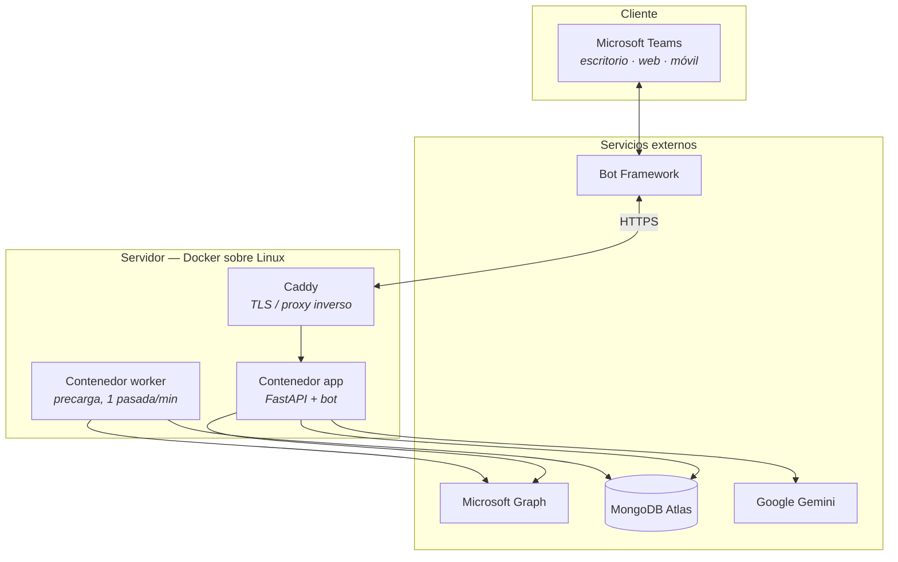
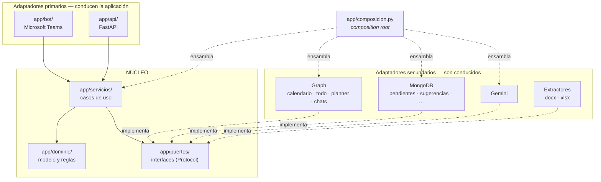
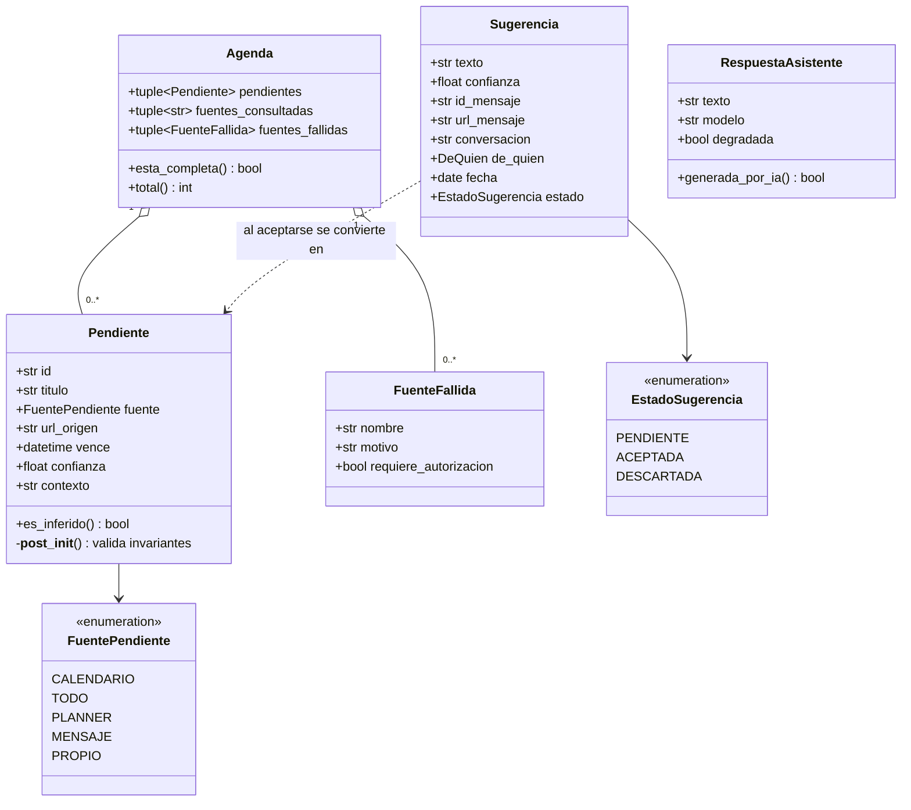
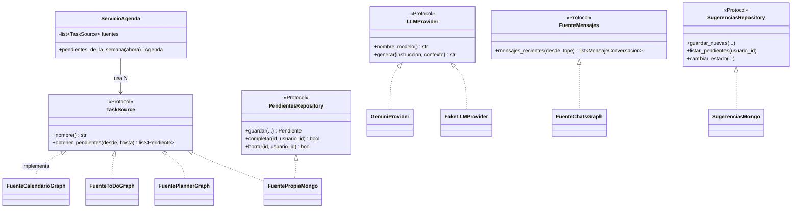
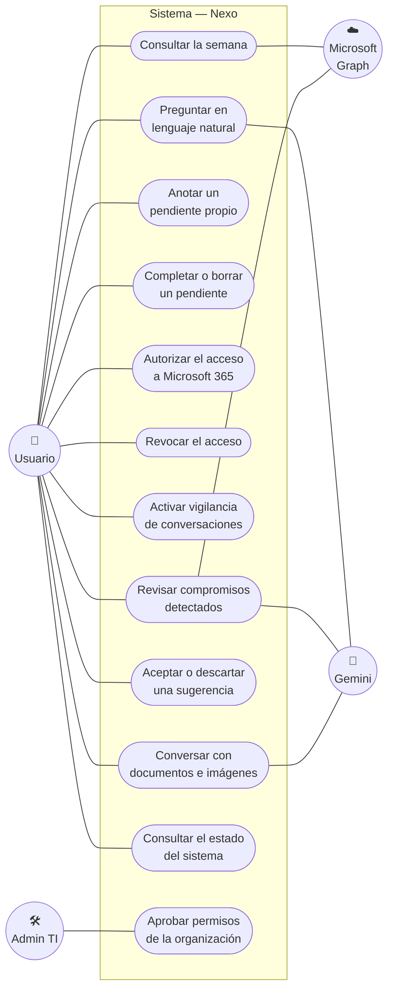
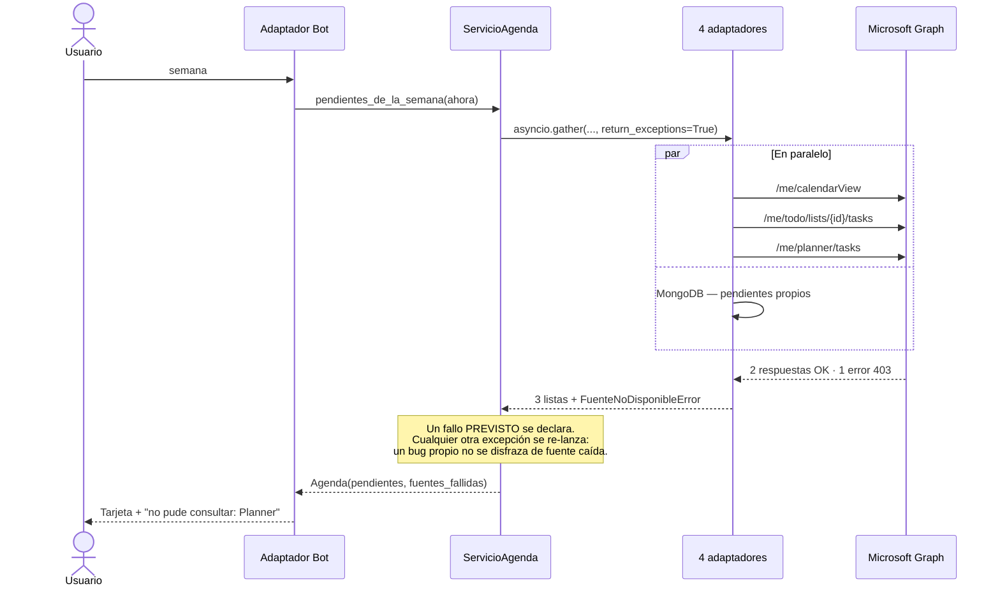
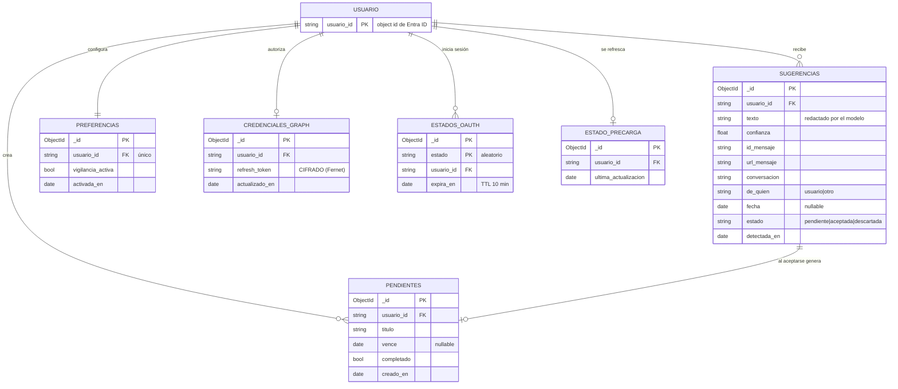
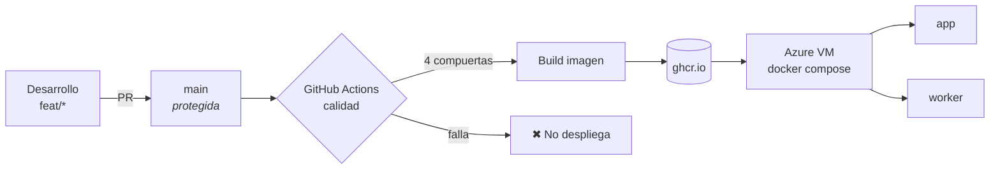

# Definición técnica de arquitectura — Nexo

> Documento de arquitectura de la solución y documentación de desarrollo.
> Universidad Pontificia Bolivariana · Proyecto en TIC 1 · Octubre 2026

---

## 1. Visión general

Nexo es un **agente conversacional dentro de Microsoft Teams** que unifica los compromisos de una persona —dispersos en calendario, To Do, Planner y conversaciones— y los devuelve en una sola respuesta con enlace a su origen.

### Estilo arquitectónico: hexagonal (puertos y adaptadores)

El criterio que ordena todo el sistema es una sola regla:

> **El núcleo de negocio no sabe que existen Microsoft Teams, Microsoft Graph, MongoDB ni Gemini.** Solo conoce interfaces propias.

Esa regla no es estética. Tiene tres consecuencias medibles:

| Consecuencia | Evidencia |
|---|---|
| Se puede probar sin infraestructura | **272 tests** corren sin red, sin credenciales y sin base de datos |
| Añadir un origen de datos es barato | De 1 a 4 fuentes **sin tocar** `ServicioAgenda` ni `Agenda` |
| Se puede cambiar de proveedor | Sustituir Gemini es escribir un adaptador, no rediseñar |

### Vista de contenedores



**Por qué dos contenedores.** La precarga de datos de Graph tarda segundos. Si viviera dentro del bot, cada `semana` esperaría a cuatro llamadas remotas y Teams daría sensación de lentitud. Separar el `worker` es lo que hace que la respuesta sea inmediata: el bot lee lo que el worker ya dejó listo.

---

## 2. Capas y dependencias



### Las cuatro reglas de dependencia

| # | Regla | Por qué |
|---|---|---|
| 1 | `dominio/` **solo** usa librería estándar | Si el dominio importa infraestructura, deja de ser el modelo del problema y pasa a ser el modelo de la herramienta |
| 2 | `servicios/` depende de **puertos**, nunca de adaptadores | Permite probar cada caso de uso con dobles |
| 3 | Un adaptador secundario **no llama** a un servicio | Si lo hiciera, la dependencia se invertiría y el núcleo dejaría de ser el centro |
| 4 | Solo `composicion.py` ensambla implementaciones concretas | Un único sitio donde mirar para saber qué está conectado |

### Se verifica sola

`tests/test_arquitectura.py` es una **función de aptitud**: recorre el árbol sintáctico (AST) de cada archivo y falla si alguna regla se rompe.

```python
# Si alguien escribe esto en app/servicios/…
from app.adaptadores.gemini_provider import GeminiProvider

# el test falla con:
#   "Un servicio depende de puertos, no de implementaciones"
```

No es decorativa: **atrapó al propio equipo** colocando una fábrica en `servicios/` durante el desarrollo del esqueleto.

---

## 3. Diagrama de clases

### 3.1 — Modelo de dominio



**Tres decisiones visibles en el diagrama:**

1. **`Agenda` lleva `fuentes_fallidas`.** No es un detalle de registro: es parte de la respuesta. Una agenda que oculta que Planner falló **miente por omisión**. Un `200 OK []` significa "no tienes nada"; un `403` significa "no pude preguntar". Confundirlos es el error que el modelo entero está diseñado para impedir.

2. **`Pendiente.confianza` distingue hecho de inferencia.** Lo que viene de un sistema estructurado vale `1.0`. Lo que infiere el modelo a partir de un chat vale menos, y `es_inferido` lo hace explícito. Es el seguro contra las alucinaciones.

3. **Todo es inmutable** (`frozen=True`) y valida sus invariantes al construirse. Un `Pendiente` sin título o sin origen **no llega a existir**: no hay que acordarse de comprobarlo más tarde.

### 3.2 — Puertos y adaptadores



> **Los puertos son `typing.Protocol`, no clases base abstractas.** La diferencia importa: con `Protocol` el adaptador **no importa la interfaz** — basta con que tenga la forma correcta, y mypy lo verifica estáticamente. Eso mantiene la flecha de dependencia apuntando siempre hacia el núcleo. Con herencia, cada adaptador tendría que importar el puerto, y el acoplamiento sería real aunque el diagrama dijera lo contrario.

> **`FakeLLMProvider` no es código de prueba desechado en `tests/`.** Es un adaptador de pleno derecho: permite que los 272 tests ejerciten el camino completo de una pregunta sin red, sin API key y sin gastar cuota.

---

## 4. Diagrama de casos de uso



### Relaciones entre casos

| Caso | Relación | Con | Significado |
|---|---|---|---|
| Consultar la semana | `«include»` | Autorizar acceso | Sin autorización, muestra datos de ejemplo y lo advierte |
| Revisar compromisos | `«include»` | Activar vigilancia | Si está apagada, Nexo lo dice y no analiza nada |
| Aceptar sugerencia | `«extend»` | Anotar pendiente propio | Al aceptar, la sugerencia se convierte en un pendiente con `confianza = 1.0` |

### Caso principal detallado — *Consultar la semana*

| | |
|---|---|
| **Actor** | Usuario autenticado en Teams |
| **Precondición** | Ha ejecutado `conectar` y consentido los permisos |
| **Flujo principal** | 1. Escribe `semana` → 2. El sistema consulta **las cuatro fuentes en paralelo** → 3. Unifica y ordena por vencimiento → 4. Devuelve una tarjeta con el origen y el enlace de cada pendiente |
| **Flujo alterno A** | Una fuente falla → el sistema **declara cuál** y muestra las demás |
| **Flujo alterno B** | Falta autorización → botón de inicio de sesión |
| **Postcondición** | El usuario ve sus compromisos con trazabilidad al origen |



---

## 5. Diagrama de base de datos

**MongoDB (orientada a documentos).** No hay relaciones gestionadas por el motor: la integridad la garantiza la aplicación, y **el vínculo que importa en todas las colecciones es `usuario_id`**.



### Índices

```javascript
db.pendientes.createIndex({ usuario_id: 1, completado: 1, vence: 1 })
db.sugerencias.createIndex({ usuario_id: 1, estado: 1 })
db.preferencias.createIndex({ usuario_id: 1 }, { unique: true })
db.credenciales_graph.createIndex({ usuario_id: 1 }, { unique: true })
db.estados_oauth.createIndex({ expira_en: 1 }, { expireAfterSeconds: 0 })
```

### Tres decisiones de datos

**1. `usuario_id` es el object id de Entra ID, nunca el correo.** Un correo es un dato personal y además cambia cuando alguien cambia de apellido; el object id no cambia nunca.

**2. Toda consulta filtra por `usuario_id` — en lectura y en escritura.** Un `find({})` sin filtro le enseñaría a un usuario los pendientes de otro: es OWASP A01, *Broken Access Control*. Y un `update_one({_id})` sin `usuario_id` dejaría que alguien completara el pendiente ajeno conociendo un id. Hay un test automático que fija ambas direcciones.

**3. No existe ninguna colección con el texto de los mensajes de Teams.** Al analizar conversaciones, el texto se procesa en memoria y se descarta: en `sugerencias` queda lo que **redactó el modelo** y la URL del mensaje. El original se queda en Teams, bajo las políticas de retención del tenant. **Nexo no crea una segunda copia de las conversaciones de la organización.**

---

## 6. Decisiones de arquitectura (resumen)

El detalle, con las alternativas descartadas y su porqué, está en [`PLAN-COMPLETO.md`](PLAN-COMPLETO.md).

| ADR | Decisión | Consecuencia principal |
|---|---|---|
| 001 | Backend en Python + FastAPI | El SDK de Teams corre sobre FastAPI: bot y API en **un solo proceso** |
| 002 | Autenticación **delegada**, nunca permisos de aplicación | Nexo no puede ver nada que el usuario no vea ya |
| 003 | Desarrollo sobre tenant propio | Independencia del tenant de la universidad |
| 004 | Monolito modular hexagonal | De 1 a 4 fuentes sin tocar el núcleo |
| 005 | Modelo de dominio propio (`Pendiente`) | Normaliza cuatro vocabularios distintos en uno |
| 006 | Proveedor de LLM intercambiable | Cambiar de modelo cuesta una variable de entorno |
| 007 | MongoDB Atlas como almacén | *Recortado a propósito:* documentos e historial sí, vectores no (ventana real de 8 semanas) |
| 008 | Generación progresiva | *Recortado a propósito:* la tarjeta ya es breve |
| 009 | Teams como canal primario | Riesgo de rúbrica aceptado y documentado |
| 010 | Lectura de conversaciones **opt-in** | Seis reglas de privacidad; el texto nunca se almacena |

---

## 7. Atributos de calidad

| Atributo | Cómo se consigue | Cómo se comprueba |
|---|---|---|
| **Fiabilidad** | Las fuentes se consultan en paralelo; una caída no tumba las demás | Test de fuente caída; prueba manual quitando `MONGODB_URI` |
| **Honestidad** | Un fallo nunca se traduce en lista vacía | Test: `403` → `FuenteSinPermisoError`, no `[]` |
| **Seguridad** | Delegado · solo lectura · aislamiento por `usuario_id` · tokens cifrados · fallar cerrado | Tests de aislamiento; `401` sin token en `/api/messages` |
| **Mantenibilidad** | Función de aptitud sobre el AST | 4 sabotajes deliberados: los 4 fallan |
| **Testabilidad** | Todo detrás de puertos | **272 tests** sin red ni credenciales |
| **Rendimiento** | Worker de precarga separado del bot | La respuesta no espera a Graph |
| **Operabilidad** | `/health` · logs con causa · degradación por partes | Reinicio completo siguiendo el runbook |

### Compuertas de calidad

Cuatro, verificadas **en entorno limpio** antes de cada entrega:

```bash
ruff check .          # estilo y errores comunes
ruff format --check . # formato
mypy                  # tipos, modo strict
pytest                # 272 tests
```

> **Un `venv` reusado no verifica una instalación.** El script `verificar-ci.ps1` recrea el entorno desde cero porque un conflicto de dependencias solo aparece en una instalación limpia — y el runner de CI siempre instala desde cero. Esa lección costó un despliegue roto antes de adoptarse como regla.

---

## 8. Despliegue



El job `desplegar` **depende** de `calidad`: si una compuerta falla, no se construye la imagen y no se despliega. La compuerta no depende de que alguien se acuerde de ejecutarla.

---

<div align="center">
<sub>Universidad Pontificia Bolivariana · Proyecto en TIC 1 · 2026</sub>
</div>
