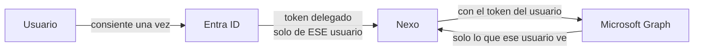

# 11 · Privacidad y cumplimiento

Esta página es para quien tiene que **aprobar** Nexo: seguridad, legal o el responsable de datos. Está escrita para responder las preguntas antes de que las hagan.

## El modelo de acceso

Nexo usa **autenticación delegada**: actúa con el token de cada usuario, nunca con una identidad de aplicación sobre la organización.

**Consecuencia práctica: no existe ningún modo en que Nexo vea datos que el usuario no pueda ver ya abriendo Outlook o Teams.** No hay una ruta privilegiada, ni siquiera para un administrador del sistema.

## Permisos, uno por uno

Todos **delegados** y **de solo lectura**.

| Permiso | Alcance real | Consentimiento |
|---|---|---|
| `User.Read` | Perfil básico propio | Usuario |
| `Calendars.Read` | Calendario propio | Usuario |
| `Tasks.Read` | To Do y Planner propios | Usuario |
| `Chat.ReadBasic` | Lista de chats propios | Usuario |
| `Chat.Read` | Mensajes de esos chats | Usuario |
| `Group.Read.All` | **Pertenencia** a grupos (no su contenido) | **Administrador** |
| `offline_access` | Renovar sin pedir login otra vez | Usuario |

**No se piden:** escritura de ningún tipo · correo · archivos · permisos de aplicación · acceso a datos de otros usuarios.

## Datos almacenados

En **tu** clúster de MongoDB, en **tu** región.

| Colección | Contenido | Dato personal | Retención |
|---|---|---|---|
| `pendientes` | Texto que el usuario escribió con `recuérdame` | Sí | Hasta borrarlo |
| `sugerencias` | Compromiso **redactado por el modelo** + enlace al mensaje | Sí | Hasta aceptar o descartar |
| `preferencias` | Si activó la vigilancia | Mínimo | Mientras use Nexo |
| `credenciales_graph` | *Refresh token* **cifrado (Fernet)** | Sí | Hasta `desconectar` |
| `estados_oauth` | Estado temporal del login | No | 10 minutos |
| `estado_precarga` | Marca de tiempo | No | Mientras use Nexo |

El identificador de usuario es el **object id de Entra ID**, no el correo: un correo es un dato personal y además cambia cuando alguien cambia de apellido.

### Lo que NUNCA se almacena

- ❌ Contraseñas
- ❌ **Cuerpos de mensajes de Teams**
- ❌ Copias de eventos, tareas o planes de Microsoft
- ❌ Bytes de las imágenes enviadas al chat

> El punto clave para una auditoría: cuando Nexo analiza conversaciones, **el texto se procesa en memoria y se descarta**. Lo que queda es el pendiente que redactó el modelo y la URL del mensaje. **El original se queda en Teams**, bajo las políticas de retención y eDiscovery que tu organización ya tiene. Nexo no crea una segunda copia de las conversaciones de la empresa.

## El punto que hay que decidir conscientemente

**Google procesa texto de tu organización.** Es el único momento en que algo sale hacia un tercero que no es Microsoft:

| Función | Qué sale |
|---|---|
| Preguntas en lenguaje natural | Títulos y fechas de los pendientes, y la pregunta |
| `chat` | La pregunta y los últimos turnos |
| Documentos adjuntos | El texto extraído |
| **`revisar`** | **El texto de los mensajes de 7 días de los chats de quien activó `vigilar`** |

La última fila incluye **palabras escritas por terceros** que no instalaron Nexo. Mitigaciones de diseño:

1. **Opt-in por usuario** (`vigilar`), revocable (`no vigilar`)
2. **Ventana de 7 días**, nunca el histórico
3. **No se almacena el texto**
4. **Lo detectado es una propuesta**, no un dato

Aun así, el texto sale. **Revisa las condiciones de tratamiento de datos de Google antes de aprobarlo para información sensible.**

> Si tu organización no puede enviar texto a un proveedor externo, hay salida: el modelo vive detrás de un puerto (`LLMProvider`), así que se puede sustituir por uno que corra **dentro de tu red** escribiendo un adaptador, sin tocar el núcleo. Es trabajo de desarrollo, pero no es un rediseño.

## Derechos de los usuarios

| Derecho | Cómo se ejerce |
|---|---|
| **Saber qué se guarda** | Esta página y `docs/PRIVACIDAD.md` |
| **Revocar el acceso** | `desconectar` en el chat, o *Mis aplicaciones* de Microsoft |
| **Dejar de ser analizado** | `no vigilar` |
| **Borrar la memoria del chat** | `olvidar` |
| **Borrar sus pendientes** | `borrar <n>`, o solicitud al administrador |
| **Eliminar todo** | El administrador borra sus documentos de las colecciones |

## Seguridad técnica

| Control | Implementación |
|---|---|
| Transporte | HTTPS obligatorio; Bot Framework rechaza HTTP plano |
| Autenticación de peticiones | `/api/messages` exige token de Bot Framework (**401** sin él) |
| **Fallar cerrado** | Sin `TEAMS_BOT_ID` fuera de `local`, **la app no arranca** |
| Aislamiento entre usuarios | Toda consulta a Mongo filtra por `usuario_id`, en lectura y escritura, con test que lo fija |
| Secretos en reposo | *Refresh tokens* cifrados con Fernet; clave solo en el servidor |
| Secretos en la imagen | `.dockerignore` excluye `.env`; la imagen no contiene credenciales |
| Inyección de prompts | El texto de terceros viaja como dato; el modelo solo devuelve estructura cerrada |

> **"Fallar cerrado" merece una línea.** Si falta la credencial del bot en producción, la aplicación se niega a arrancar en lugar de aceptar mensajes sin autenticar. Un fallo de arranque se ve en los logs en dos segundos; un endpoint abierto a internet no se ve nunca.

## Antes de aprobar: lista del responsable de datos

- [ ] Región de MongoDB Atlas compatible con la residencia de datos exigida
- [ ] Condiciones de tratamiento de Google revisadas (§ el punto de decisión)
- [ ] Decidido si la lectura de conversaciones se permite, y para qué grupos
- [ ] `BRUJULA_TOKEN_ENCRYPTION_KEY` custodiada en el gestor de secretos
- [ ] Política de copias y de retención definida
- [ ] Informados: Microsoft, MongoDB Atlas y Google como subencargados
- [ ] Comunicado a los usuarios qué hace `vigilar` antes de activarlo en masa

Siguiente: [Preguntas frecuentes](12-Preguntas-frecuentes).
