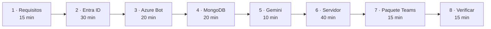

# Implantar Nexo en tu organización

Esta wiki es la guía completa para que **una empresa instale Nexo en su propio Microsoft 365**, de principio a fin.

Está escrita para que alguien que no participó en el desarrollo pueda leerla, entender qué está haciendo en cada paso y dejar el sistema funcionando.

> **Reparto de responsabilidades.** Nosotros desarrollamos y mantenemos el software. **Las cuentas, suscripciones, credenciales y costes son de la empresa que lo implanta**: así nadie externo custodia los secretos de tu organización, y puedes auditar y revocar todo sin depender de nosotros.

---

## Cuánto cuesta y cuánto tarda

| | |
|---|---|
| **Tiempo total** | 2 a 3 horas la primera vez, repartidas en 8 pasos |
| **Conocimiento necesario** | Saber moverse en el portal de Azure y en una terminal de Linux |
| **Coste mínimo** | Desde **0 USD/mes** (capas gratuitas) hasta ~15 USD/mes con VM propia |
| **Lo más lento** | La propagación del DNS y del certificado (hasta 1 hora) |

---

## El mapa completo

## Qué vas a crear

| Recurso | Dónde | Para qué | Coste |
|---|---|---|---|
| **Registro de aplicación** | Entra ID (Azure) | Que Nexo pueda pedir permiso para leer los datos del usuario | Gratis |
| **Azure Bot** | Azure | Que Teams sepa a qué servidor mandar los mensajes | Gratis (SKU F0) |
| **Clúster MongoDB** | MongoDB Atlas | Guardar pendientes propios, sugerencias y preferencias | Gratis (M0) |
| **Clave de API** | Google AI Studio | El modelo que redacta e infiere | Capa gratuita |
| **Servidor con HTTPS** | Donde prefieras | Ejecutar el contenedor | ~15 USD/mes |
| **Paquete de Teams** | Un `.zip` | Instalar el bot en la organización | Gratis |

---

## Antes de empezar, lee esto

Hay **dos identidades distintas** en este sistema y confundirlas es el error que más tiempo cuesta:

| Identidad | Qué es | Dónde se crea |
|---|---|---|
| **App de Entra ID** | Pide permiso al usuario para leer su calendario, tareas y chats | Paso 3 |
| **Azure Bot** | Permite a Teams entregar mensajes a tu servidor | Paso 4 |

Son **dos registros diferentes, con dos identificadores diferentes**. En la configuración son `AZURE_CLIENT_ID` y `TEAMS_BOT_ID`. Si los intercambias, el bot responde pero no ve ningún dato, o ve los datos pero no responde — y el mensaje de error no te dirá cuál de las dos es.

**Empieza por [Requisitos previos](02-Requisitos-previos).**
